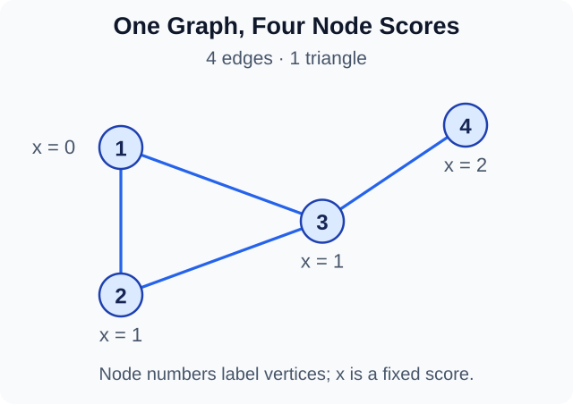
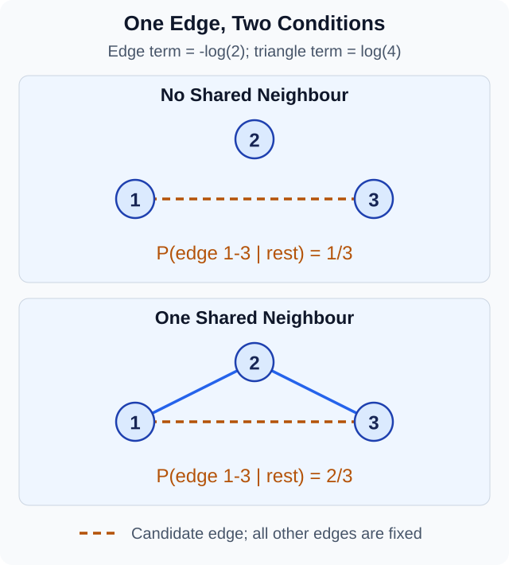
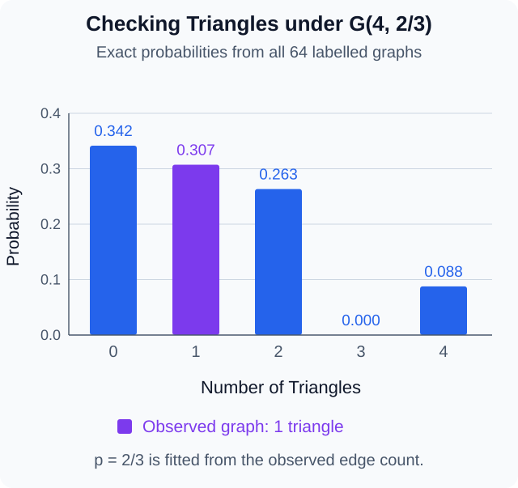

## From Random Edges to Network Structure

The [previous note](random-networks.qmd) studies $G(n,p)$. Every possible edge has the same probability. Edge choices are independent.

This is a useful baseline. It also raises two questions. What if some nodes have a greater chance of making connections? What if an edge is more likely when its endpoints already share a neighbour?

These are different changes to the model. The first can keep edges independent. The second introduces dependence between edges.

An **exponential random graph model**, or **ERGM**, gives a probability to each possible network. We will build the idea from simple likelihoods. Then we will use a small triangle model to see what dependence means.

Throughout, graphs are simple, undirected, and labelled. There are no loops. The node set is fixed. Write $A$ for a random adjacency matrix and $a$ for the graph we observe. Treating $a$ as one draw is a modelling choice. It does not require a literal collection of repeated networks.

## Fitting the Independent-Edge Model

### A Graph Probability Is Not an Edge-Count Probability

Let $n\geq2$ be the number of nodes and $N=\binom n2$ the number of possible edges. Suppose the observed graph has

$$
m=\sum_{i<j}a_{ij}
$$

edges. Under $G(n,p)$, its probability is

$$
\Pr_p(A=a)=p^m(1-p)^{N-m}.
$$

The graph specifies exactly which edges are present. There is no binomial coefficient here.

By contrast, the event that the edge count $M$ equals $m$ includes $\binom Nm$ different graphs:

$$
\Pr_p(M=m)=\binom Nm p^m(1-p)^{N-m}.
$$

This distinction helps us keep the data clear. We may observe a whole graph even when our chosen model uses only its edge count to estimate $p$.

### Maximum Likelihood

Once $a$ is fixed, its probability becomes a function of $p$. This is the **likelihood**. Maximum likelihood chooses the parameter that gives the observed data the greatest probability.

For $0<p<1$, the log-likelihood is

$$
\ell(p)=m\log p+(N-m)\log(1-p).
$$

If $0<m<N$, differentiation gives

$$
\begin{aligned}
\ell'(p)&=\frac m p-\frac{N-m}{1-p},\\
\ell'(p)=0&\quad\Longrightarrow\quad\widehat p=\frac m N.
\end{aligned}
$$

The second derivative is negative. Thus the observed edge density is the unique maximiser. When $m=0$ or $m=N$, the maximiser on $[0,1]$ is the corresponding endpoint. A finite log-odds parameter cannot represent those endpoints exactly.

The estimate matches the edge count **in expectation**:

$$
\mathbb E_{\widehat p}[M]=N\widehat p=m.
$$

It does not force every new graph to have $m$ edges. Nor does it fit clustering, degrees, or distances separately.

### A Four-Node Example

Consider the graph with edges

$$
E=\{\{1,2\},\{1,3\},\{2,3\},\{3,4\}\}.
$$

There are $N=6$ possible edges and $m=4$ observed edges. The degrees are $(2,2,3,1)$. There is one triangle, on nodes $1,2,3$.

{#fig-ergm-four-nodes width=640 fig-align="center"}

The node scores in the figure are fixed values for a later example. They are not measurements from a real network.

The independent-edge estimate is $\widehat p=2/3$. The fitted probability of this particular labelled graph is

$$
\left(\frac23\right)^4\left(\frac13\right)^2
=\frac{16}{729}.
$$

Every other labelled graph with four edges has this same probability under the fitted model. The model cannot distinguish their shapes. That is a useful way to see what its single parameter leaves out.

## Letting Node Features Affect Edges

### Why Use Log-Odds?

A **covariate** is a measured feature used by a model. For now, give each node a fixed numerical feature $x_i$. Collect them in $x=(x_1,\ldots,x_n)$.

Write

$$
p_{ij}=\Pr(A_{ij}=1\mid x).
$$

For $0<p_{ij}<1$, its **odds** are $p_{ij}/(1-p_{ij})$. The **log-odds**, or **logit**, are

$$
\eta_{ij}=\log\frac{p_{ij}}{1-p_{ij}}.
$$

The logit can be any real number. Solving for $p_{ij}$ gives

$$
p_{ij}=\frac{e^{\eta_{ij}}}{1+e^{\eta_{ij}}}
=\frac{1}{1+e^{-\eta_{ij}}}.
$$

This is the **logistic function**. It converts a real-valued score into a valid probability. It does not make that score a probability itself.

### A Symmetric Model for an Undirected Edge

One simple choice is

$$
\eta_{ij}=\beta_0+\beta_1(x_i+x_j).
$$

Using the sum makes the expression symmetric in $i$ and $j$. Relabelling the two endpoints does not change their edge probability.

Here $\beta_0$ is the log-odds when the endpoint sum is zero. Increasing $x_i+x_j$ by one multiplies the odds by $e^{\beta_1}$. It does not add $\beta_1$ to the probability.

This is an activity model. For $\beta_1>0$, larger scores raise connection probabilities. It is not a model of similarity. Two nodes with very different scores can still have a large sum. A similarity model would need a different feature, such as $-|x_i-x_j|$.

The Statnet Development Team (2026, “Nodal Covariates”) discusses this distinction for the `nodecov` model term.

### Exact Probabilities in the Small Example

Use the four scores from @fig-ergm-four-nodes:

$$
x=(0,1,1,2).
$$

Choose $\beta_0=-\log3$ and $\beta_1=\log2$. These are illustrative parameter values, not estimates from the four-node graph. Then

$$
\frac{p_{ij}}{1-p_{ij}}=\frac{2^{x_i+x_j}}{3}.
$$

| Endpoint Sum | Odds | Edge Probability |
| ---: | ---: | ---: |
| $1$ | $2/3$ | $2/5$ |
| $2$ | $4/3$ | $4/7$ |
| $3$ | $8/3$ | $8/11$ |

Pairs $\{1,2\}$ and $\{1,3\}$ have sum $1$. Pairs $\{1,4\}$ and $\{2,3\}$ have sum $2$. The other two pairs have sum $3$.

The odds double from one row to the next. The probabilities do not.

Expected degree is still a sum of edge probabilities:

$$
\mathbb E[D_i\mid x]=\sum_{j\ne i}p_{ij}.
$$

For node $4$, this is $4/7+8/11+8/11=156/77\approx2.026$. Its observed degree is only $1$. A model describes a range of possible outcomes. A positive coefficient does not impose an ordering on observed degrees.

## From Edge Probabilities to a Whole-Graph Model

### State the Independence Assumption

Assume the edge variables are independent **given the full vector $x$**. Then

$$
\Pr_\beta(A=a\mid x)
=\prod_{i<j}p_{ij}^{a_{ij}}(1-p_{ij})^{1-a_{ij}}.
$$

Shared endpoints do not invalidate this assumption. The node features are fixed here. Dependence could appear if unobserved random node effects were added and then averaged out. That would be another model.

Substituting the logistic expression gives

$$
\begin{aligned}
&\Pr_\beta(A=a\mid x)\\
&\quad=\frac{\exp\{\beta_0T_0(a)+\beta_1T_1(a,x)\}}
{\kappa(\beta,x)}.
\end{aligned}
$$

Here

$$
\begin{aligned}
T_0(a)&=\sum_{i<j}a_{ij},\\
T_1(a,x)&=\sum_{i<j}a_{ij}(x_i+x_j),\\
\kappa(\beta,x)&=\prod_{i<j}(1+e^{\eta_{ij}}).
\end{aligned}
$$

The first statistic counts edges. The second also has a useful node-based form:

$$
T_1(a,x)=\sum_i x_i d_i(a).
$$

Each present edge contributes the score of both endpoints. Collecting terms by node gives the identity. In the observed example, $T_1=0\cdot2+1\cdot2+1\cdot3+2\cdot1=7$.

This changes how we see the model. Instead of assigning separate edge probabilities first, we can assign a weight to each graph using a few graph statistics.

### The General ERGM Form

Let $\mathcal G_n$ contain all simple undirected graphs on these $n$ labelled nodes. It has $2^N$ elements. Choose statistics $T_0,\ldots,T_K$. For finite parameters, define

$$
\begin{aligned}
&\Pr_\theta(A=a\mid x)\\
&\quad=\frac{\exp\{\sum_{r=0}^K\theta_rT_r(a,x)\}}
{\kappa(\theta,x)},\\
&\kappa(\theta,x)\\
&\quad=\sum_{b\in\mathcal G_n}
\exp\{\sum_{r=0}^K\theta_rT_r(b,x)\}.
\end{aligned}
$$

The **normalising constant** $\kappa$ makes the probabilities sum to one. It depends on the parameters and on the fixed covariates. It is constant across possible graphs for one parameter choice. It is not constant when we change the parameters to fit the model.

This is the finite, unrestricted, binary ERGM form used here. Other sample spaces are possible; we do not need them in this note. Hunter et al. (2008, Section 3) give the general framework.

The earlier logistic model fits this form. Its normaliser factors into a product because its exponent is a sum of separate edge contributions. More general graph statistics need not allow this factorisation. ERGM does not mean independent edges.

## How a Triangle Term Introduces Dependence

Let

$$
t(a)=\sum_{i<j<k}a_{ij}a_{ik}a_{jk}
$$

be the number of triangles. Each triple contributes one exactly when all three edges are present. Consider the model

$$
\Pr_\theta(A=a)
=\frac{\exp\{\theta_E m(a)+\theta_T t(a)\}}
{\kappa(\theta)}.
$$

The triangle count contains products of edges. We can no longer factor the graph probability into independent Bernoulli probabilities when $n\geq3$ and $\theta_T\ne0$.

### Compare Two Graphs That Differ by One Edge

Fix every edge except $\{i,j\}$. Let $a^+$ include that edge and $a^-$ omit it. Define the **change statistic**

$$
\Delta_{ij}T_r=T_r(a^+)-T_r(a^-).
$$

The normaliser cancels when we divide the two graph probabilities. Therefore the conditional odds of this edge are

$$
\begin{aligned}
&\frac{\Pr(A_{ij}=1\mid A_{-ij}=a_{-ij},x)}
{\Pr(A_{ij}=0\mid A_{-ij}=a_{-ij},x)}\\
&\qquad=\exp\{\sum_r\theta_r\Delta_{ij}T_r\}.
\end{aligned}
$$

Here $A_{-ij}$ means all edge variables except the chosen one. Taking logarithms gives a linear expression in the change statistics.

Adding one edge changes the edge count by one. It creates one triangle for each shared neighbour. Write

$$
s_{ij}=\sum_{k\ne i,j}a_{ik}a_{jk}.
$$

For the edge-and-triangle model,

$$
\begin{aligned}
&\Pr(A_{ij}=1\mid A_{-ij}=a_{-ij})\\
&\qquad=\frac{1}{1+\exp\{-(\theta_E+\theta_Ts_{ij})\}}.
\end{aligned}
$$

For $\theta_T>0$, an extra shared neighbour multiplies the conditional odds by $e^{\theta_T}$. This is an exact interpretation while the remaining edges are fixed. It is not a causal claim about how a network formed over time.

{#fig-ergm-toggle width=640 fig-align="center"}

The figure uses $\theta_E=-\log2$ and $\theta_T=\log4$. A shared neighbour multiplies the odds by four. The probability changes from $1/3$ to $2/3$.

### Check the Whole Distribution on Three Nodes

There are only eight labelled graphs on three nodes. Only the complete graph has a triangle. We can sum their weights exactly for the same parameters.

| Edges per Graph | Number of Graphs | Weight per Graph |
| ---: | ---: | ---: |
| $0$ | $1$ | $1$ |
| $1$ | $3$ | $1/2$ |
| $2$ | $3$ | $1/4$ |
| $3$ | $1$ | $1/2$ |

Thus

$$
\kappa=1+3\left(\frac12\right)
+3\left(\frac14\right)+\frac12=\frac{15}{4}.
$$

The triangle probability is $(1/2)/(15/4)=2/15$. Also,

$$
\begin{aligned}
\mathbb E[M]
&=\frac{3/2+3/2+3/2}{15/4}\\
&=\frac65.
\end{aligned}
$$

All three edges have the same marginal probability by symmetry. Since their expectations add to $\mathbb E[M]$, each has probability $2/5$.

This gives three different numbers for one edge: the marginal probability $2/5$, and the conditional probabilities $1/3$ or $2/3$. The marginal value averages over the unknown remaining edges. The conditional values fix them.

If we set $\theta_T=0$ while keeping $\theta_E=-\log2$, the model becomes $G(3,1/3)$. Its triangle probability is $1/27$ and its expected edge count is $1$. Changing the triangle coefficient alters both quantities. It does not hold density fixed automatically.

## What Does Fitting an ERGM Try to Match?

With fixed $x$, the log-likelihood is

$$
\ell(\theta)=\sum_r\theta_rT_r(a,x)
-\log\kappa(\theta,x).
$$

Differentiating the finite sum defining $\kappa$ gives

$$
\frac{\partial\ell}{\partial\theta_r}
=T_r(a,x)-\mathbb E_\theta[T_r(A,x)].
$$

So a finite interior maximum satisfies

$$
\mathbb E_{\widehat\theta}[T_r(A,x)]=T_r(a,x).
$$

This extends $N\widehat p=m$. Fitting balances each observed model statistic against its expected value. It does not force every draw to copy the observed graph.

::: {.callout-note collapse="true" title="Where the Derivative Comes From"}

For one component,

$$
\begin{aligned}
\frac{\partial\log\kappa}{\partial\theta_r}
&=\frac{1}{\kappa}\frac{\partial\kappa}{\partial\theta_r}\\
&=\sum_{b\in\mathcal G_n}T_r(b,x)\Pr_\theta(A=b\mid x)\\
&=\mathbb E_\theta[T_r(A,x)].
\end{aligned}
$$

The sum is finite, so we may differentiate each term. This calculation explains why the normaliser matters for estimation. Dropping it would also drop the expected-statistic term.

For the independent logistic model, the same log-likelihood can be written

$$
\ell(\beta)=\sum_{i<j}
\left[a_{ij}\eta_{ij}-\log(1+e^{\eta_{ij}})\right].
$$

Its two likelihood equations are

$$
\begin{aligned}
\sum_{i<j}(a_{ij}-p_{ij})&=0,\\
\sum_{i<j}(x_i+x_j)(a_{ij}-p_{ij})&=0.
\end{aligned}
$$

In general, these equations need a numerical solution. The intercept-only model is the earlier closed-form exception.

:::

A finite maximum need not exist. The empty and complete graphs already show this for the edges-only log-odds parameter. More parameters can also be impossible to distinguish from the available data. Numerical output alone does not settle these issues.

General models bring another difficulty. Even at $n=20$, there are $2^{190}$ possible graphs. Directly summing the normaliser is impractical. Simulation-based methods are often used. Their algorithms are beyond this note.

## Checking Fit Beyond the Fitted Statistics

A model can match density yet miss the degree distribution or distances. A fitted coefficient and a small standard error answer a different question from “Does this model reproduce the structure we care about?”

One check is to draw new graphs from the fitted model. Keep the node set and fixed features the same. Compute a statistic $S$ in each draw, then compare its distribution with $S(a)$. Useful checks include triangles, degree frequencies, component sizes, and shortest-path distances. The `ergm` goodness-of-fit documentation describes such simulated comparisons (Statnet Development Team, n.d.).

Choose some checks that were not used as model terms. Matching an edge count in expectation gives little evidence about triangle fit. When comparing distances, keep unreachable pairs as a separate category. Silently discarding them can hide disconnected graphs.

### A Check We Can Compute Exactly

Return to the four-node graph. The edges-only fit was $G(4,2/3)$. We did not use its triangle count when fitting. By linearity of expectation,

$$
\mathbb E[t(A)]
=\binom43\left(\frac23\right)^3
=\frac{32}{27}.
$$

Each triple is a triangle with probability $p^3$. Different triangle indicators can be dependent, but expectation still adds.

Since there are only $64$ graphs, we can obtain the full distribution without simulation:

$$
\begin{aligned}
&\Pr(t(A)=r)\\
&\quad=\sum_{b:\,t(b)=r}
\left(\frac23\right)^{m(b)}
\left(\frac13\right)^{6-m(b)}.
\end{aligned}
$$

{#fig-ergm-triangle-check width=640 fig-align="center"}

The observed count is one. This is an ordinary value in the displayed distribution. It does not show a clear triangle mismatch. It also does not establish that the model fits every other feature.

Three triangles cannot occur on four nodes. Any three distinct triples together require all six edges, which also complete the fourth triangle. The zero in the plot is a structural restriction, not a simulation error.

The fitted probability $2/3$ is held fixed for this comparison. The plot is a model check. It is not a confidence interval for $p$, or a calibrated hypothesis test that accounts for estimating $p$ from this graph.

## What These Models Can and Cannot Explain

There are three steps worth keeping separate. Node features can change marginal edge probabilities. Triangle terms can make an edge depend on the rest of the graph. Fit checks can then ask whether the chosen distribution captures useful structure.

Adding more terms does not guarantee a useful model. Some edge-and-triangle parameter choices put most probability on almost empty or almost complete graphs. This behaviour is often called **degeneracy**. A model can therefore contain a clustering term and still describe the observed network poorly; see Hunter et al. (2008, Section 3).

A fitted association is also not a cause. An unmeasured feature may affect both a node score and its connections. A static graph model does not specify which edge formed first.

The main mathematical idea is to define probabilities for whole graphs, then work out what those probabilities imply locally. The normaliser, change statistics, and expected-statistic equations connect these two views.

## A Short Check

In the three-node edge-and-triangle model, suppose $A_{12}=1$ and $A_{23}=0$. What is the conditional probability that $A_{13}=1$? Does the answer have to equal its marginal probability?

::: {.callout-note collapse="true" title="Count Shared Neighbours First"}

Nodes $1$ and $3$ do not share node $2$ as a neighbour, because edge $\{2,3\}$ is absent. Thus $s_{13}=0$ and

$$
\Pr(A_{13}=1\mid A_{12}=1,A_{23}=0)=\frac13.
$$

Its marginal probability is still $2/5$. Conditioning has fixed the other two edges. The marginal probability averages over all four configurations of those edges, weighted by their model probabilities.

:::

## References

Hunter, D. R., Handcock, M. S., Butts, C. T., Goodreau, S. M., & Morris, M. (2008). ergm: A package to fit, simulate and diagnose exponential-family models for networks. *Journal of Statistical Software, 24*(3), 1–29. [https://doi.org/10.18637/jss.v024.i03](https://doi.org/10.18637/jss.v024.i03)

Statnet Development Team. (2026, June 22). *Exponential random graph models (ERGMs) using statnet*. [https://statnet.org/workshop-ergm/ergm_tutorial.html](https://statnet.org/workshop-ergm/ergm_tutorial.html)

Statnet Development Team. (n.d.). *Conduct goodness-of-fit diagnostics on an exponential family random graph model* [R documentation]. [https://search.r-project.org/CRAN/refmans/ergm/html/gof.html](https://search.r-project.org/CRAN/refmans/ergm/html/gof.html)

---

[Previous: Random Networks and Connectivity](random-networks.qmd) · [MATH1972 Seminar Notes](index.qmd)
