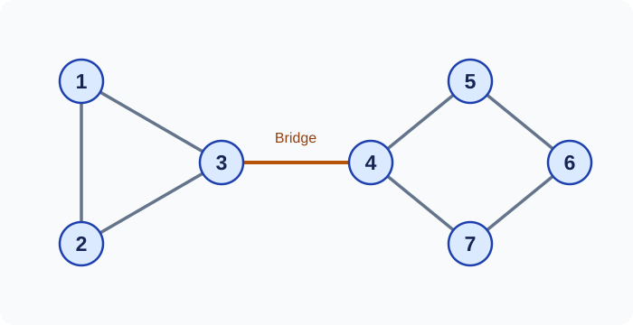
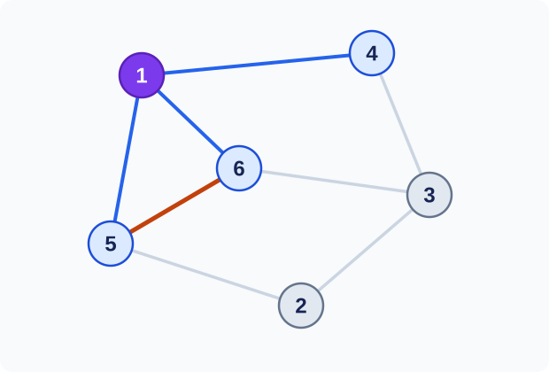
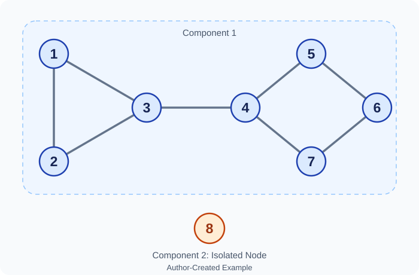

## Why Study Connections?

A list of people tells us who belongs to a group. It does not tell us who knows whom. Those connections can change how news spreads through the group. The same idea appears in transport, communication, and biology.

Network analysis studies a system through its objects and their connections. We represent the objects by **nodes**. We represent their connections by **edges**. The resulting mathematical object is a **graph**.

This note uses one small graph throughout. The graph and numerical examples in this note were constructed for these notes. The aim is to understand what each measure tells us. It is just as useful to know what a measure leaves out.

## One Graph, Several Representations

We use a **simple undirected graph**. An edge has no direction. There are no edges from a node to itself, and no repeated edges.

Let the node set be

$$
V=\{1,2,3,4,5,6,7\}.
$$

The edge set is

$$
\begin{aligned}
E=\{&\{1,2\},\{2,3\},\{3,1\},\{3,4\},\\
    &\{4,5\},\{5,6\},\{6,7\},\{7,4\}\}.
\end{aligned}
$$

Each edge is an unordered pair. The pair $\{1,2\}$ is the same edge as $\{2,1\}$. We count it once.

{#fig-example-network width=700 fig-align="center"}

The graph has two simple parts: a triangle and a four-cycle. The edge $\{3,4\}$ joins them. It is a **bridge**: removing it splits the graph into two components.

A drawing helps us see the connections. Its exact shape is not part of the graph. We can move a node without changing any edge. Two edges may also cross in a drawing without creating a new node.

This is a useful first distinction. A graph records *which objects are linked*. A layout chooses *where to draw them*.

### The Adjacency Matrix

The **adjacency matrix** records the same information in a table. Its entry $a_{ij}$ is $1$ when nodes $i$ and $j$ share an edge. Otherwise, it is $0$.

$$
A=\begin{pmatrix}
0&1&1&0&0&0&0\\
1&0&1&0&0&0&0\\
1&1&0&1&0&0&0\\
0&0&1&0&1&0&1\\
0&0&0&1&0&1&0\\
0&0&0&0&1&0&1\\
0&0&0&1&0&1&0
\end{pmatrix}.
$$

The diagonal entries are zero because we exclude self-loops. Also, $A=A^\mathsf{T}$. An undirected edge joins $i$ to $j$ in both readings of the matrix.

The drawing and the matrix have different strengths. The drawing makes a triangle easy to spot. The matrix makes systematic calculations easier. Neither is a more complete description of this labelled graph.

## Degree: How Many Direct Connections?

The **degree** $k_i$ counts the edges attached to node $i$. We can read it from row $i$ of the matrix:

$$
k_i=\sum_{j=1}^{n}a_{ij}.
$$

Here $n=7$, and the degrees are

| Node $i$ | 1 | 2 | 3 | 4 | 5 | 6 | 7 |
|---|---:|---:|---:|---:|---:|---:|---:|
| Degree $k_i$ | 2 | 2 | 3 | 3 | 2 | 2 | 2 |

Node $3$ has three direct neighbors: $1$, $2$, and $4$. Its degree does not count a node reached through a longer route.

### Why the Degrees Add to Twice the Edge Count

Let $m=|E|$ be the number of edges. Every edge has two ends. When we add all the degrees, we count each end once. Therefore,

$$
\sum_{i=1}^{n}k_i=2m.
$$

This is the **handshaking lemma**. In our graph,

$$
2+2+3+3+2+2+2=16=2\cdot8.
$$

The average degree is thus

$$
\bar{k}=\frac{2m}{n}=\frac{16}{7}.
$$

This gives a quick check on a calculation. A simple undirected graph cannot have an odd sum of degrees.

### The Degree Distribution

Suppose we choose one node uniformly at random. Let $K$ be its degree. If $n_k$ nodes have degree $k$, then

$$
\Pr(K=k)=p_k=\frac{n_k}{n}.
$$

For this graph,

$$
p_2=\frac57,
\qquad
p_3=\frac27.
$$

All other probabilities are zero. These values add to one, as they should.

The degree distribution is discrete. It assigns a probability to each possible integer degree. A histogram can show this distribution, but the heights need the right scale. The area of a density histogram and the probability at one degree are not always the same quantity.

## Density: How Full Is the Graph?

A simple undirected graph on $n$ nodes has at most

$$
\binom n2=\frac{n(n-1)}2
$$

edges. This counts every pair of distinct nodes once.

The **edge density** is the fraction of those possible edges that are present:

$$
\rho=\frac{m}{\binom n2}.
$$

Our graph has

$$
\rho=\frac8{21}\approx0.381.
$$

Equivalently, $\rho=\bar{k}/(n-1)$. This is the average fraction of other nodes that a node is linked to.

Degree and density answer related questions at different scales. Degree concerns one node. Density concerns all possible pairs in the graph. Neither tells us how edges are arranged among a node's neighbors.

## Clustering: Are My Neighbors Linked?

The **local clustering coefficient** asks how often a node's neighbors are linked to each other. If node $i$ has $k_i\geq2$ neighbors, there are $\binom{k_i}{2}$ possible edges among them.

Let $L_i$ be the number of those edges that are present. Then

$$
C_i=\frac{L_i}{\binom{k_i}{2}}
=\frac{2L_i}{k_i(k_i-1)}.
$$

The value lies between $0$ and $1$. It measures the density *inside the neighbor set*, rather than the density of the whole graph.

### A Local Calculation

The neighbors of node $3$ are $1$, $2$, and $4$. They have three possible pairs. Only $\{1,2\}$ is an edge.

{#fig-node-three-neighborhood width=700 fig-align="center"}

Therefore,

$$
k_3=3,\qquad L_3=1,\qquad C_3=\frac13.
$$

The full list is

$$
(C_1,C_2,C_3,C_4,C_5,C_6,C_7)
=\left(1,1,\frac13,0,0,0,0\right).
$$

Node $4$ also has degree $3$, but its clustering coefficient is $0$. Its neighbors are $3$, $5$, and $7$. None of those pairs is linked. Equal degrees can therefore hide very different local structures.

For a node of degree $0$ or $1$, the formula divides by zero. We use the convention $C_i=0$ for such nodes in this note. Some software reports an undefined value instead. That choice also affects an average (igraph, n.d.).

### Average Local Clustering Is Not Global Transitivity

The **average local clustering coefficient** gives every node equal weight:

$$
\bar C=\frac1n\sum_{i=1}^{n}C_i
=\frac17\left(1+1+\frac13\right)=\frac13.
$$

There is another common graph measure called **global transitivity**. It uses connected triples. A connected triple has a chosen center and two distinct neighbors. It is closed when those neighbors also share an edge.

If $T$ is the number of triangles, then

$$
C_{\mathrm{global}}
=\frac{3T}{\sum_i\binom{k_i}{2}}.
$$

Each triangle closes three triples, one at each of its nodes. Our graph has one triangle: $\{1,2,3\}$. It has

$$
\sum_i\binom{k_i}{2}
=1+1+3+3+1+1+1=11
$$

connected triples. Hence,

$$
C_{\mathrm{global}}=\frac3{11}\approx0.273,
\qquad
\bar C=\frac13\approx0.333.
$$

These measures ask different questions. The local average starts by choosing a node uniformly. Global transitivity starts by choosing a connected triple uniformly. Nodes with more neighbor pairs receive more weight in the second calculation. The igraph documentation treats these as distinct measures (igraph, n.d.).

## Walks, Paths, and Matrix Powers

A **walk** follows a sequence of edges. It may revisit a node or an edge. A **path** has no repeated nodes. The length is the number of edges used.

This distinction matters when we multiply adjacency matrices. The entry $(A^r)_{ij}$ counts walks of length $r$ from $i$ to $j$. It does not generally count paths.

For two steps,

$$
(A^2)_{ij}=\sum_{\ell=1}^{n}a_{i\ell}a_{\ell j}.
$$

The term for $\ell$ is $1$ exactly when we can travel from $i$ to $\ell$ and then to $j$. Summing over $\ell$ counts all choices of the middle node.

In our graph,

$$
(A^2)_{46}=2.
$$

The two walks are $4\to5\to6$ and $4\to7\to6$. Both happen to be paths.

However,

$$
(A^2)_{11}=2.
$$

These walks are $1\to2\to1$ and $1\to3\to1$. They repeat node $1$, so they are not paths. This is a simple way to see why the general claim must use the word *walk*.

More generally, each multiplication adds one final edge. This gives the walk-counting rule for all positive integers $r$.

## Distance and Diameter

The **distance** $d_{ij}$ is the length of a shortest path from $i$ to $j$. We set $d_{ii}=0$.

For distinct reachable nodes,

$$
d_{ij}=\min\{r\geq1:(A^r)_{ij}>0\}.
$$

We minimise the *number of steps* $r$, not the matrix entry. The first positive entry tells us when a route becomes possible.

Why does a statement about walks give the shortest path length? If a walk repeats a node, it contains a closed detour. Removing that detour makes the walk shorter. A shortest walk therefore has no repeated nodes.

For our graph,

$$
D=\begin{pmatrix}
0&1&1&2&3&4&3\\
1&0&1&2&3&4&3\\
1&1&0&1&2&3&2\\
2&2&1&0&1&2&1\\
3&3&2&1&0&1&2\\
4&4&3&2&1&0&1\\
3&3&2&1&2&1&0
\end{pmatrix}.
$$

For example, $d_{16}=4$. Two shortest paths are $1\to3\to4\to5\to6$ and $1\to3\to4\to7\to6$. Every route from the triangle to the four-cycle must cross the bridge. Notice that the distance is one number even when several shortest paths exist.

The **diameter** of a connected graph is its largest distance:

$$
\operatorname{diam}(G)=\max_{i,j}d_{ij}.
$$

The largest entry in $D$ is $4$. Therefore, the diameter is $4$. The pair $(1,6)$ attains it, as does $(2,6)$.

### What If the Graph Is Disconnected?

A graph is **connected** if every pair of nodes has a path between them. A **connected component** is a maximal connected part of the graph.

Now add an eighth node without any edges.

{#fig-isolated-node width=700 fig-align="center"}

There are two components: $\{1,2,3,4,5,6,7\}$ and $\{8\}$. The new node has degree $0$. No path joins it to the other seven nodes.

We write $d_{i8}=\infty$ for $i\neq8$. Under the maximum-distance definition, the diameter of the whole graph is then infinite. Some texts leave it undefined. Some software reports the largest *finite* distance instead, which is $4$ here. A reported diameter needs its convention.

The extra node also changes several summaries. There are still eight edges, but there are now $\binom82=28$ possible pairs. Density falls to $8/28=2/7$. Under our zero convention, average local clustering falls to $7/24$. Global transitivity stays at $3/11$, since the isolated node adds no connected triples.

This example shows why the node set matters. Adding an isolated node leaves every old connection in place, but it changes the questions answered by several averages.

## Reading the Measures Together

| Measure | Question It Answers | What It Does Not Show |
|---|---|---|
| Degree | How many direct neighbors does this node have? | Whether those neighbors are linked. |
| Degree distribution | How common is each degree? | Which particular nodes are linked. |
| Density | What fraction of possible edges is present? | Where those edges are placed. |
| Local clustering | How connected are this node's neighbors? | How far the node is from the rest of the graph. |
| Distance | How few edges connect this pair? | How many different routes exist. |
| Diameter | How long is the longest shortest route? | The typical route length. |

A network measure is a summary, rather than a full description. Two graphs can share a degree distribution and still have different triangles or distances. A drawing is also a summary. A neat layout does not prove that the network has a particular structure.

For real data, the meaning of an edge needs care. A friendship survey and a message log record different kinds of connection. Missing people or missing edges can change degrees, components, and distances. An undirected model also loses information when the original relation has a direction.

The practical lesson is to state the graph model first. Then choose a measure that matches the question. A useful number needs both a calculation and an interpretation.

## A Short Check

Suppose we remove the bridge $\{3,4\}$ from the original seven-node graph. What happens to connectivity, the degree sum, density, and clustering?

::: {.callout-note collapse="true" title="Work Through the Change"}

The graph splits into a triangle on $\{1,2,3\}$ and a four-cycle on $\{4,5,6,7\}$. No path joins these components.

The edge count falls from $8$ to $7$. Nodes $3$ and $4$ each lose one neighbor. The degree sum falls by $2$, from $16$ to $14$.

The node count stays at $7$, so the density becomes $7/21=1/3$.

The triangle remains. Each of its three nodes now has local clustering $1$. The four-cycle nodes still have local clustering $0$. Thus, average local clustering rises from $1/3$ to $3/7$.

Every node now has degree $2$. There are seven connected triples and one triangle, so global transitivity is also $3/7$.

Both clustering measures rise, even though the graph has lost its only link between the two parts. Higher clustering does not by itself mean better connectivity.

:::

## References

igraph. (n.d.). *Transitivity of a graph*. [https://r.igraph.org/reference/transitivity.html](https://r.igraph.org/reference/transitivity.html)

---

[Next: Random Networks and Connectivity](random-networks.qmd) · [MATH1972 Seminar Notes](index.qmd)
