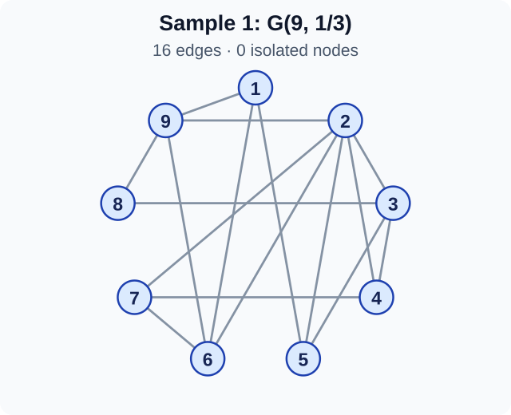
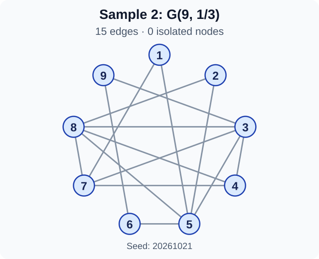
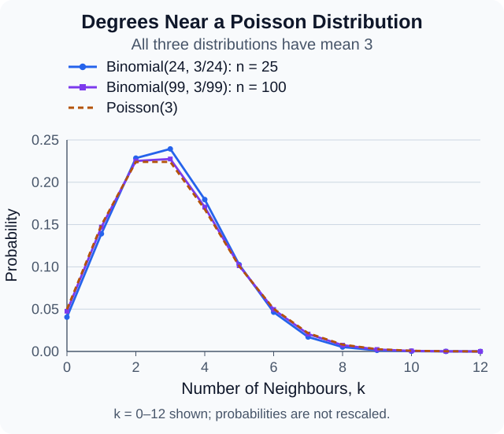
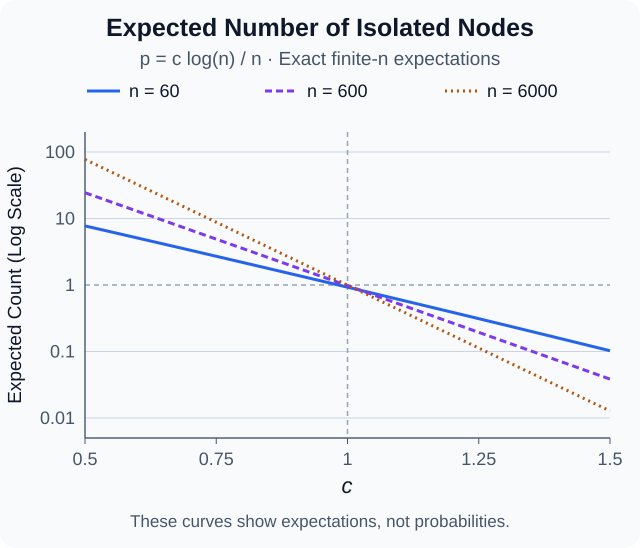

## From a Network to a Random Model

The [previous note](network-analysis.qmd) describes a fixed graph. Its edges are already known. We can count degrees, triangles, and distances.

A different question comes next. Could a feature of this graph arise from a simple random process? To answer it, we need a model that produces whole graphs.

A **random graph model** is a probability distribution on graphs. Each draw gives one possible network. The model does not say that a real network was built by tossing coins. It gives a baseline for comparison.

The choice of baseline matters. A graph may look unusual under independent edges but ordinary under another model. An unexpected result can reveal a poor model, rather than a surprising real-world cause.

This note starts with the simplest edge model. The main tools are sums of indicator variables, expectation, and variance. We will distinguish exact calculations, limiting results, and useful estimates.

## Building the Model One Edge at a Time

Fix a set of $n\geq2$ labelled nodes. We use a simple undirected graph. There are no self-loops or repeated edges.

For every unordered pair $\{i,j\}$, include its edge with probability $p$. Make these choices independently. Here $0\leq p\leq1$.

The resulting model is written $G(n,p)$. It is often called the **Erdős–Rényi model**, or the binomial random graph model.

Define an **indicator variable** for each possible edge:

$$
B_{ij}=\begin{cases}
1,&\text{if the edge }\{i,j\}\text{ is present},\\
0,&\text{otherwise}.
\end{cases}
$$

Each $B_{ij}$ has a Bernoulli distribution. In particular,

$$
\mathbb E[B_{ij}]=p,
\qquad
\operatorname{Var}(B_{ij})=p(1-p).
$$

Expectation is a probability-weighted mean. Variance measures squared spread around that mean: $\operatorname{Var}(Y)=\mathbb E[(Y-\mathbb E[Y])^2]$.

There are $N=\binom n2$ possible edges. For $0<p<1$, a particular graph $H$ with $m$ edges has probability

$$
\Pr(G=H)=p^m(1-p)^{N-m}.
$$

We need $m$ successful edge choices and $N-m$ unsuccessful ones. Independence lets us multiply their probabilities.

The model fixes $n$ and $p$, not the edge count. This differs from $G(n,m)$, which chooses uniformly among graphs with exactly $m$ edges. We use $G(n,p)$ throughout.

## Edge Counts and Degrees

### The Number of Edges

Let $M$ be the random number of edges. Then

$$
M=\sum_{i<j}B_{ij}.
$$

This is a sum of $N$ independent Bernoulli variables. Therefore,

$$
M\sim\operatorname{Bin}(N,p),
\qquad N=\binom n2.
$$

The notation $\operatorname{Bin}(N,p)$ means the number of successes in $N$ independent trials, each with success probability $p$.

For $r=0,\ldots,N$,

$$
\Pr(M=r)=\binom Nr p^r(1-p)^{N-r}.
$$

The binomial coefficient counts the choices of the $r$ present edges. Linearity of expectation gives

$$
\mathbb E[M]=Np.
$$

Independence also lets us add the variances:

$$
\operatorname{Var}(M)=Np(1-p).
$$

These two facts use different assumptions. Expectations add even without independence. Variances need covariance terms when the variables are dependent.

### The Degree of One Node

Let $D_i$ be the degree of node $i$. Only the $n-1$ edges touching $i$ matter:

$$
D_i=\sum_{j\ne i}B_{ij}.
$$

Here we write $B_{ji}=B_{ij}$ for the same undirected edge. Thus,

$$
\begin{aligned}
D_i&\sim\operatorname{Bin}(n-1,p),\\
\mathbb E[D_i]&=(n-1)p,\\
\operatorname{Var}(D_i)&=(n-1)p(1-p).
\end{aligned}
$$

The mean is the same for every node. It does not follow that all nodes have the same degree in a draw.

The handshaking lemma still holds in every draw:

$$
\sum_{i=1}^n D_i=2M.
$$

Taking expectations gives $n(n-1)p=2Np$. This checks that the local and whole-graph calculations agree.

### Independent Edges, Dependent Degrees

Covariance records how two quantities vary together. For random variables $U$ and $V$, its formula is

$$
\operatorname{Cov}(U,V)
=\mathbb E[UV]-\mathbb E[U]\mathbb E[V].
$$

Two different degrees share one random choice: the edge between their nodes. For $i\ne j$,

$$
\operatorname{Cov}(D_i,D_j)=p(1-p).
$$

To see this, write $D_i=B_{ij}+U$ and $D_j=B_{ij}+V$. The sums $U$ and $V$ involve disjoint sets of edges. Both are independent of $B_{ij}$. All covariance terms vanish except $\operatorname{Var}(B_{ij})$.

When $0<p<1$, the covariance is positive. Seeing a larger degree at one node gives a little information about the other. The degree variables are not independent, even though the edge variables are.

### A Small Example

Take $G(9,1/3)$. There are $36$ possible edges, so

$$
\begin{aligned}
\mathbb E[M]&=12,&\operatorname{Var}(M)&=8,\\
\mathbb E[D_i]&=\frac83,&\operatorname{Var}(D_i)&=\frac{16}{9}.
\end{aligned}
$$

The two draws below use the same node positions and the same model. Only the edge choices change.

{#fig-random-sample-one width=640 fig-align="center"}

{#fig-random-sample-two width=640 fig-align="center"}

The edge counts are $16$ and $15$, not $12$. There is no contradiction. An expectation is a probability-weighted average over all possible draws. It is not a requirement for one draw, or even for these two draws together.

## Why a Poisson Distribution Appears

Suppose the graph grows while individual edges become rarer. Write the edge probability as $p_n$, and assume

$$
p_n\to0,
\qquad (n-1)p_n\to\lambda>0.
$$

The expected degree stays close to $\lambda$. Each node has many possible neighbors, but each connection is unlikely.

For a fixed integer $k\geq0$, the binomial formula gives

$$
\begin{aligned}
\Pr(D_i=k)
&=\binom{n-1}{k}p_n^k\\
&\quad\cdot(1-p_n)^{n-1-k}.
\end{aligned}
$$

Put $s=n-1$. We can separate the expression into three factors:

$$
\begin{aligned}
\Pr(D_i=k)
&=\frac{(sp_n)^k}{k!}
\left[\prod_{r=0}^{k-1}\left(1-\frac r s\right)\right]\\
&\quad\cdot(1-p_n)^{s-k}.
\end{aligned}
$$

The product is $1$ when $k=0$. For any fixed $k$, its factors tend to $1$. The first factor tends to $\lambda^k/k!$.

For the final factor, use $\log(1-p_n)=-p_n+O(p_n^2)$. Since $sp_n^2\to0$,

$$
(s-k)\log(1-p_n)\to-\lambda.
$$

Here $O(p_n^2)$ means that the error is bounded by a constant times $p_n^2$ for small $p_n$. It follows that

$$
\Pr(D_i=k)\longrightarrow e^{-\lambda}\frac{\lambda^k}{k!}.
$$

The right side is the probability mass function of $\operatorname{Poisson}(\lambda)$. We write

$$
D_i\xrightarrow{d}\operatorname{Poisson}(\lambda).
$$

The arrow means convergence in distribution. It does not turn a finite binomial variable into an exact Poisson variable.

{#fig-degree-poisson width=720 fig-align="center"}

In this comparison, $p_n=3/(n-1)$. The binomial mean is exactly $3$ for both graph sizes. Its variance is $3(1-3/(n-1))$, which approaches the Poisson variance $3$.

The probability at degree zero matters too. It tells us how often a node has no neighbors. That leads to a question about the whole graph.

## Counting Isolated Nodes

A node is **isolated** when its degree is zero. Let $I_i$ indicate that node $i$ is isolated, and let

$$
X=\sum_{i=1}^n I_i
$$

be the total number of isolated nodes.

Node $i$ is isolated exactly when all its $n-1$ possible edges are absent. Hence,

$$
q:=\Pr(I_i=1)=(1-p)^{n-1}.
$$

Linearity of expectation now gives the exact identity

$$
\mu:=\mathbb E[X]=n(1-p)^{n-1}.
$$

We did not assume that the isolation indicators are independent. For $0<p<1$, they are not independent.

For the earlier $G(9,1/3)$ example,

$$
\mathbb E[X]
=9\left(\frac23\right)^8
=\frac{256}{729}\approx0.351.
$$

The number of isolated nodes must be an integer. Its expectation need not be. A mean below one also does not mean that isolated nodes are impossible.

### Where Does the Logarithm Come From?

One way to locate a possible transition is to ask when $\mathbb E[X]=1$. Solving the exact equation gives

$$
\begin{aligned}
n(1-p)^{n-1}&=1,\\
p_*&=1-n^{-1/(n-1)}.
\end{aligned}
$$

Since $n^{-1/(n-1)}=\exp(-\log n/(n-1))$,

$$
p_*\sim\frac{\log n}{n}.
$$

The notation $a_n\sim b_n$ means that $a_n/b_n\to1$. All logarithms in this note are natural logarithms.

This calculation identifies a useful scale. It does not prove a transition in probability. We must still connect a mean to the chance that $X$ is zero.

{#fig-isolated-expectation width=720 fig-align="center"}

The curves use $n=60$, $600$, and $6000$. The line at height one marks $\mathbb E[X]=1$. The crossing approaches $c=1$ as $n$ grows. It is not exactly at $c=1$ for a finite graph.

## Two Probability Bounds

### Markov's Inequality

If $Y\geq0$ and $t>0$, then

$$
\Pr(Y\geq t)\leq\frac{\mathbb E[Y]}{t}.
$$

The proof is short. Pointwise, $Y\geq t\,\mathbf 1_{\{Y\geq t\}}$. Taking expectations gives the result. The symbol $\mathbf 1$ is another notation for an indicator.

Markov turns a small mean into a small chance of a large value. The nonnegative assumption is essential.

### Chebyshev's Inequality

If $Y$ has finite variance and $t>0$, apply Markov to $(Y-\mathbb E[Y])^2$:

$$
\begin{aligned}
&\Pr(|Y-\mathbb E[Y]|\geq t)\\
&\quad=\Pr((Y-\mathbb E[Y])^2\geq t^2)\\
&\quad\leq\frac{\operatorname{Var}(Y)}{t^2}.
\end{aligned}
$$

Chebyshev controls deviation from the mean. If the variance is small compared with the square of the mean, relative deviations become unlikely.

There is no converse to Markov that says a large mean forces a positive value with high probability. For example, let $Y_n=n^2$ with probability $1/n$, and let $Y_n=0$ otherwise. Then $\mathbb E[Y_n]=n\to\infty$, but $\Pr(Y_n>0)=1/n\to0$.

This is why the lower side of our threshold argument needs a variance calculation.

## When Do Isolated Nodes Disappear?

Set

$$
p_n=\frac{c\log n}{n},
\qquad c>0\text{ fixed}.
$$

For sufficiently large $n$, this is a valid probability. Taking logarithms of the exact expectation gives

$$
\begin{aligned}
\log\mu_n
&=\log n+(n-1)\log(1-p_n)\\
&=(1-c)\log n+o(1).
\end{aligned}
$$

Here $o(1)$ denotes a quantity that tends to zero. The error vanishes because $np_n^2=c^2(\log n)^2/n\to0$. Thus,

$$
\mu_n\sim n^{1-c}.
$$

### Above the Threshold: $c>1$

Now $\mu_n\to0$. Since $X$ is a nonnegative integer, Markov gives

$$
\Pr(X\geq1)\leq\mathbb E[X]=\mu_n\to0.
$$

Therefore $\Pr(X=0)\to1$. We have proved that isolated nodes disappear **with high probability**. This phrase means that the probability of the stated event tends to one as $n\to\infty$.

We have not yet proved that the graph is connected. There could still be a component with several nodes and no edges leading out of it.

### Below the Threshold: $0<c<1$

Here $\mu_n\to\infty$. We also need to show that $X$ stays close to its mean.

For $0<p<1$, direct calculation gives

$$
\frac{\operatorname{Var}(X)}{\mu^2}
=\frac{1-q}{nq}
+\frac{n-1}{n}\frac{p}{1-p}.
$$

The first term is at most $1/\mu_n$. The second tends to zero because $p_n\to0$. Hence, for every $\varepsilon>0$,

$$
\Pr\left(\left|\frac{X}{\mu_n}-1\right|\geq\varepsilon\right)
\leq\frac{\operatorname{Var}(X)}{\varepsilon^2\mu_n^2}
\longrightarrow0.
$$

This is **convergence in probability**: the chance of any fixed relative error tends to zero. We write $X/\mu_n\xrightarrow{p}1$.

In particular, the event $X=0$ has relative deviation exactly one. Taking $\varepsilon=1$ shows that $\Pr(X=0)\to0$. Below the threshold, isolated nodes occur with high probability.

::: {.callout-note collapse="true" title="Why the Isolation Indicators Are Dependent"}

For two distinct nodes $i$ and $j$ to be isolated, every edge touching either node must be absent. There are

$$
(n-1)+(n-1)-1=2n-3
$$

such edges. We subtract one because the shared edge $\{i,j\}$ appeared in both lists. Therefore,

$$
\mathbb E[I_iI_j]=(1-p)^{2n-3}.
$$

Since $\mathbb E[I_i]\mathbb E[I_j]=q^2=(1-p)^{2n-2}$,

$$
\operatorname{Cov}(I_i,I_j)
=p(1-p)^{2n-3}.
$$

The covariance is positive for $0<p<1$. Learning that $i$ is isolated already tells us that the shared edge is absent. This makes isolation of $j$ slightly more likely.

Expanding the variance of the sum gives

$$
\begin{aligned}
\operatorname{Var}(X)
&=\sum_i\operatorname{Var}(I_i)\\
&\quad+2\sum_{i<j}\operatorname{Cov}(I_i,I_j)\\
&=nq(1-q)\\
&\quad+n(n-1)p(1-p)^{2n-3}.
\end{aligned}
$$

Divide by $\mu^2=n^2q^2$ to obtain the relative variance used above. Ignoring covariance would miss the second term.

:::

### At the Threshold: $c=1$

When $p_n=\log n/n$, the same expectation calculation gives

$$
\mu_n\to1,
$$

not infinity. The relative variance above tends to one, not zero. The concentration argument for $c<1$ therefore does not apply.

A more precise theorem gives

$$
\begin{gathered}
X\xrightarrow{d}\operatorname{Poisson}(1),\\
\Pr(X=0)\to e^{-1}\approx0.368.
\end{gathered}
$$

This result is stated without proof here; see Frieze and Karoński (2026, Section 3.1). It is not a consequence of knowing the mean alone.

The critical case has a genuine chance of either outcome. It cannot be grouped with the range $0<c<1$.

## No Isolated Nodes Is Not the Same as Connected

Consider a triangle and a four-cycle with no edge between them. Every node has degree two. There are no isolated nodes, but the graph has two components.

This example shows that

$$
\{G\text{ is connected}\}\subseteq\{X=0\},
$$

and the reverse inclusion can fail. Therefore,

$$
\Pr(G\text{ is connected})\leq\Pr(X=0).
$$

For $0<c<1$, our isolation proof already shows that the graph is disconnected with high probability. For $c>1$, ruling out isolated nodes is only part of the work.

The full connectivity theorem for $G(n,c\log n/n)$ says

$$
\begin{gathered}
\Pr(G\text{ is connected})\\
\longrightarrow
\begin{cases}
0,&0<c<1,\\
e^{-1},&c=1,\\
1,&c>1.
\end{cases}
\end{gathered}
$$

We quote the part that needs more than our isolation argument. The missing step controls components of size at least two. Frieze and Karoński (2026, Section 4.1) give a proof.

Thus isolated nodes identify the correct connectivity scale. They do not give a deterministic test for connectivity in an arbitrary graph.

## Why Short Routes Can Appear

Return to the sparser scale

$$
p_n=\frac{\lambda}{n},
\qquad\lambda>1\text{ fixed}.
$$

The mean degree approaches $\lambda$. In this regime, a standard result gives a **giant component** with high probability. Its size is a positive fraction of $n$; see Frieze and Karoński (2026, Section 2.2).

A large component is not the same as a connected graph. The exact isolation formula gives

$$
\frac{\mathbb E[X]}{n}
=\left(1-\frac{\lambda}{n}\right)^{n-1}
\longrightarrow e^{-\lambda}>0.
$$

The relative-variance calculation also shows concentration in this regime. Indeed, $\mu_n\sim ne^{-\lambda}\to\infty$ and $p_n\to0$. It follows that $X/n\xrightarrow{p}e^{-\lambda}$.

Many isolated nodes remain, even while the giant component exists. Under the previous note's distance convention, the whole graph has infinite diameter with high probability.

### A Layer-by-Layer Estimate

Start from a node in the giant component. **Breadth-first search** visits nodes one edge away, then two edges away, and so on.

Early in the search, imagine that each new node reveals about $\lambda$ new neighbors. Ignoring repeated discoveries gives layer sizes of roughly

$$
1,\lambda,\lambda^2,\ldots,\lambda^r.
$$

The sum grows on the scale of $\lambda^r$. To reach a number of nodes on the scale of $n$, solve $\lambda^r\approx n$:

$$
r\approx\frac{\log n}{\log\lambda}.
$$

This is a heuristic for the typical distance between nodes in the giant component. It is not an exact finite-graph formula. It does not describe the distance between every pair, or the maximum distance.

For instance, if $\lambda=3$ and $n=59049=3^{10}$, the estimate is about $10$ steps. Multiplying the network size by $3$ adds about one step to this estimate.

Repeated discoveries and small branches affect actual distances. The argument also fails at $\lambda=1$, where the denominator is zero. We should not use it there by taking a numerical limit.

The main insight is about scales. The number of possible routes can grow quickly with each extra step. Short typical routes can therefore coexist with a large number of nodes.

## What the Model Leaves Out

The model treats every node pair in the same way. It has no built-in preference for location, shared interests, or existing popularity. This makes calculation simple, but it limits the model.

Equal degree distributions do not mean equal observed degrees. Isolated nodes and unusually large degrees can occur. The issue is that all nodes start with the same connection probability. There is no separate parameter for a highly connected individual.

Independent edges also miss some local structure. Given two neighbors of a node, the edge between those neighbors is still present with probability $p$. The model does not add a special tendency for friends of friends to connect.

This matters for the phrase **small world**. Short typical paths are one feature. Strong clustering is another. Our distance estimate alone does not establish both.

The model remains useful as a baseline. If a graph has many more triangles than this baseline predicts, that can suggest a missing mechanism. It does not identify the mechanism by itself.

The main lesson is to keep three objects separate: the observed graph, the probability model, and the statistic used to compare them.

## A Short Check

Suppose $p_n=2/n$. The mean degree approaches $2$, which is larger than one. Does this imply that the whole graph becomes connected?

::: {.callout-note collapse="true" title="Compare the Two Scales"}

No. A mean degree above one is not the connectivity condition.

Here

$$
\mu_n=n\left(1-\frac2n\right)^{n-1}\sim ne^{-2}.
$$

The mean number of isolated nodes grows linearly. The relative variance tends to zero, so $X/\mu_n\xrightarrow{p}1$. In particular, isolated nodes remain with high probability.

The giant component can contain many nodes, but it does not contain every node. Connectivity needs the larger scale $p\sim\log n/n$, rather than merely a mean degree above one.

:::

## References

Frieze, A., & Karoński, M. (2026). *Introduction to random graphs* (Author manuscript, August 7, 2026). [https://www.math.cmu.edu/~af1p/BOOK.pdf](https://www.math.cmu.edu/~af1p/BOOK.pdf)

---

[Previous: Introduction to Network Analysis](network-analysis.qmd) · [Next: Exponential Random Graph Models](exponential-random-graphs.qmd) · [MATH1972 Seminar Notes](index.qmd)
